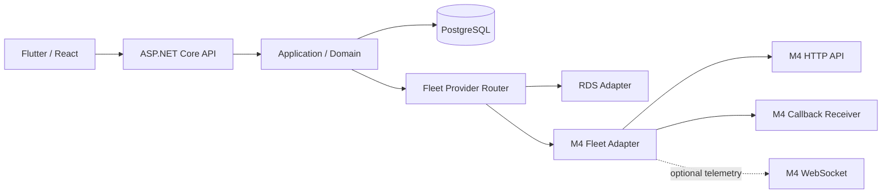

# TKG PDA — RDS'den M4 API'lerine Geçiş Planı

**Doküman durumu:** Taslak uygulama planı
**Hazırlanma tarihi:** 15 Ekim 2026
**Canlı ortam doğrulaması:** 16 Ekim 2026 — M4 `6.16.5`, `http://10.4.10.111:5800`
**Kapsam:** TKG PDA taşıma yürütme entegrasyonunun SEER RDS bağımlılıklarından M4 Fleet API'lerine kontrollü geçirilmesi
**Temel yaklaşım:** Provider abstraction + read-only discovery + simulator/staging proof + shadow comparison + machine-scoped canary + controlled cutover

---

## 1. Amaç

Bu planın amacı, TKG PDA'nın mevcut iş akışlarını ve güvenlik kurallarını koruyarak robot filo entegrasyonunu RDS adapter'ından M4 Fleet API adapter'ına taşımaktır.

Geçiş aşağıdaki kullanıcı ve domain davranışlarını değiştirmemelidir:

- Operator akışı `machine -> part -> operation` olarak kalır.
- Operator fiziksel robot, slot, point, storage bin veya scene seçmez.
- `Machine -> Variant -> Product Group -> Part / Related Part / Alternative Part` hiyerarşisi korunur.
- Desteklenen operasyonlar `BRING_EMPTY`, `BRING_FULL`, `REMOVE_FULL` ve `REMOVE_EMPTY` olarak kalır.
- `BRING_FULL`, warehouse readiness tamamlanmadan robot dispatch aşamasına geçmez.
- `TransportBatch`, bağımsız `TransportRequest` kayıtlarını gruplamaya devam eder.
- Her request kendi idempotency ve dış sistem kimliğine sahip olur.
- `VACANT`, `OCCUPIED`, `UNKNOWN` occupancy; `EMPTY`, `FULL`, `UNKNOWN` load durumları korunur.
- Fiziksel kanıt bilinmiyor, eski veya business state ile çelişkiliyse dispatch fail-close olur.
- Flutter ve React istemcileri M4'e doğrudan bağlanmaz.

Bu çalışma M4 API'lerinin TKG domain katmanının yerine geçmesini hedeflemez. M4, yalnızca filo yürütme, sorgulama ve telemetry sağlayıcısı olacaktır.

---

## 2. Kullanılan kaynaklar

### 2.1 Canlı SEER/Feishu kaynakları

Plan hazırlanırken aşağıdaki canlı sayfalar kontrol edilmiştir:

1. [M4 Development Manual](https://seer-group.feishu.cn/wiki/FghYwrQHMiJXATk74c4clvwjnsB)
   - Chinese Documents ve English Documents ağaçları
   - M4 HTTP and WebSocket Interface Documentation
   - M4 Scheduling API Documentation
   - M4 Fleet API
   - M4 Falcon Task Manual
   - M4 deployment, operation, PLC ve scripting başlıkları
2. [M4 Fleet API](https://seer-group.feishu.cn/wiki/Jvkrw1dNWiwFyNkhCogceHa9nOg)
   - order lifecycle
   - robot ve scene sorguları
   - callback registration
   - HTTP/WebSocket kullanım biçimleri
3. [M4 HTTP and WebSocket Interface Documentation](https://seer-group.feishu.cn/wiki/Bct0wnDDwiWOivk9qAZcfARCnwf)
   - JSON/UTF-8 sözleşmesi
   - HTTP status ve error body davranışı
   - authentication
   - entity query modeli
   - WebSocket mesaj modeli
4. [M4 Falcon Task Manual](https://seer-group.feishu.cn/wiki/GwamwqM66iM4fUk1I56cHIXxngh)
   - task lifecycle
   - pause/resume/retry/cancel davranışları
   - task template ve variable modeli

### 2.2 Yerel Türkçe M4 kaynakları

- [M4 Fleet API Türkçe](../scratch/m4-full-translation/translated/M4_Fleet_API_TR.md)
- [M4 Scheduling API Türkçe](../scratch/m4-full-translation/translated/M4_Scheduling_API_TR.md)
- [M4 HTTP ve WebSocket Türkçe](../scratch/m4-full-translation/translated/M4_HTTP_WebSocket_TR.md)
- [M4 Fleet Tutorial Türkçe](../scratch/m4-full-translation/translated/M4_Fleet_Tutorial_TR.md)
- [M4 Falcon Task Manual Türkçe](../scratch/m4-full-translation/translated/M4_Falcon_Task_Manual_TR.md)
- [M4 Overview Türkçe](../scratch/m4-full-translation/translated/M4_Overview_TR.md)

### 2.3 Repository kaynakları

- `src/TkgPda.Application/RdsExecution.cs`
- `src/TkgPda.Application/RdsCoreNativeOrders.cs`
- `src/TkgPda.Api/RdsExecutionClient.cs`
- `src/TkgPda.Api/RdsCoreNativeOrderClient.cs`
- `src/TkgPda.Api/RdsReadClient.cs`
- `src/TkgPda.Api/RdsCommissioningDiscoveryClient.cs`
- `src/TkgPda.Infrastructure.Postgres/PostgresRdsExecutionStore.cs`
- `src/TkgPda.Infrastructure.Postgres/PostgresRdsIntegrationStore*.cs`
- `db/migrations/001_initial_schema.sql`
- `db/migrations/022_variant_scoped_rds_worksite_commissioning.sql`
- `db/migrations/023_rds_variant_commissioning_hardening.sql`
- `db/migrations/025_profile_scoped_shared_endpoints.sql`
- `db/migrations/026_canonical_shared_endpoint_identities.sql`

### 2.4 Kaynak önceliği

Bir uyuşmazlık olduğunda aşağıdaki sıra uygulanır:

1. Sahada çalışan M4 sürümünün gerçek API davranışı
2. Aynı M4 sürümüne ait resmi canlı API dokümanı
3. Resmi İngilizce/Çince kaynak doküman
4. Yerel Türkçe çeviri
5. Bu plan içindeki yorum ve öneriler

Türkçe belgelerde çeviri kaynaklı anlam belirsizliği varsa request/response alan adları ve enum değerleri özgün İngilizce biçimleriyle değerlendirilmelidir.

---

## 3. Mevcut durum

### 3.1 Mevcut mimari

```text
Flutter / React
  -> ASP.NET Core API
  -> Application / Domain
  -> PostgreSQL
  -> RDS adapter
  -> SEER RDS
```

Mevcut yürütme yapısında:

- `RdsExecutionCoordinator` dispatch öncesi business, commissioning ve fiziksel uygunluk kontrollerini yapar.
- `IRdsExecutionStore` request lease ve robot-scoped distributed lease sağlar.
- `IRdsExecutionClient` eski RDS mutation sözleşmesini taşır.
- `IRdsCoreNativeOrderClient` native order oluşturma, sorgulama ve iptal işlerini yürütür.
- `RdsExecutionWorker` queued request'leri gönderir ve aktif işleri reconcile eder.
- `integration.rds_tasks` dış sistem task durumunu saklar.
- `integration.rds_worksites` fiziksel WorkSite mirror'ını saklar.
- `integration.layout_slot_rds_mapping` business slot ile WorkSite ilişkisini kurar.
- `integration.profile_shared_endpoint_bindings` profile bazlı warehouse/finished goods endpoint'lerini bağlar.
- `master.navigation_profiles` makine ve variant için navigasyon bağlamını taşır.

### 3.2 Korunacak güçlü yönler

- Deterministic request identity
- Transactional status transition
- Request ve robot seviyesinde distributed locking
- Restart sonrası reconciliation
- Cancellation safety
- Dispatch kill switch
- Warehouse readiness ayrımı
- Physical evidence freshness kontrolü
- Contradiction durumunda fail-close
- Admin/Operator bilgi sınırı
- Audit ve correlation kayıtları

### 3.3 Değişmesi gereken RDS bağımlılıkları

- Application sözleşmelerindeki `Rds*` isimleri
- RDS task label ve input binding modeli
- WorkSite'e özel `filled`, `locked`, `disabled`, `syncFailed` semantiği
- Navigation Profile içindeki RDS map/vehicle alanları
- API ve Admin endpoint'lerindeki `/rds/*` isimleri
- `integration.rds_tasks` ve `integration.rds_worksites` veri modeli
- `SENT_TO_RDS` gibi vendor-specific sunum metinleri
- RDS callback payload ve callback key doğrulaması
- RDS alarm ve robot telemetry adapter'ları

### 3.4 Canlı M4 6.16.5 başlangıç durumu

16 Ekim 2026 salt okunur SSH ve Web keşfinde aşağıdaki değerler doğrulanmıştır:

- M4 `6.16.5`, Windows Server üzerinde M4 Boot `2.2.1` tarafından çalıştırılmaktadır.
- M4 Web ve HTTP API `http://10.4.10.111:5800` adresindedir.
- Unauthenticated `GET /api/ping`, `401 Unauthorized` döndürerek API liveness ve auth zorunluluğunu doğrulamıştır.
- İlk keşifte scene/robot yoktu; daha sonra M4 One-click Simulation ile `OneDemo` scene etkinleştirilmiştir.
- `OneDemo` içinde 15 mock robot (Box 4, DN 3, Jack 8), iki area ve simulator map/point/path/bin yapıları doğrulanmıştır.
- Fleet TCP Server ve RBK 3.5 protocol disabled durumdadır.
- QuickStore zone/task seçimleri yapılmamıştır.
- Açık kullanıcı onayıyla oluşturulan test Agency account üzerinden machine-to-machine authentication, ping, scene list ve salt okunur `TransportOrder` query sözleşmeleri doğrulanmıştır.
- `OneDemo` demo project etkinleştirildiğinde project verileriyle birlikte Agency listesi de değişmiştir; TKG integration credential'ı her hedef project için ayrıca doğrulanacaktır.

Bu ortam runtime ve simulator read-only discovery açısından kullanılabilir, fakat production commissioning ve Contract Ready aşamasında değildir. `OneDemo` değerleri production customer mapping'i olarak kullanılmayacaktır. Ayrıntılı kanıt [M4 Sunucu Keşif Kaydı](M4_SERVER_DISCOVERY_2026-10-15.md) ve [M4 Contract Matrix](M4_CONTRACT_MATRIX.md) içindedir.

---

## 4. Hedef mimari



### 4.1 Hedef kurallar

- Her `TransportRequest` tek bir execution provider'a aittir.
- Provider request oluşturulurken seçilir ve immutable olur.
- Aynı request RDS ve M4'e birlikte dispatch edilmez.
- HTTP create/query/cancel akışı correctness kaynağıdır.
- Callback düşük gecikmeli bildirim sağlar.
- Polling reconciliation her durumda çalışır.
- WebSocket telemetry için kullanılabilir; correctness için zorunlu değildir.
- Provider'a özel modeller API response'larında Operator istemcisine sızmaz.
- Admin teknik ayrıntıları görebilir; mutation yetkisi ayrıca kontrol edilir.

---

## 5. Kapsam

### 5.1 İlk geçiş kapsamı

- M4 health ve authentication
- Scene discovery
- Robot read-only telemetry
- Point/storage-bin discovery
- Order create
- Order detail ve list query
- Order cancellation
- Order callback registration ve reception
- Polling reconciliation
- Dört TKG transport operation
- Physical endpoint evidence
- Admin commissioning görünümü
- Provider-based routing
- Shadow ve canary rollout
- Audit, metrics ve rollback

### 5.2 Ayrı faza bırakılan işlemler

- Robot soft emergency stop
- Robot enable/disable
- Robot controller ownership değişikliği
- Robot alarm clear
- Manual order complete
- Scene enable/disable
- Map point/path mutation
- Robot DI/DO mutation
- Park point yönetimi
- Charge point ve charging policy yönetimi
- M4 Falcon Task template yazımı
- PLC entegrasyonu
- VDA 5050 entegrasyonu

Bu işlemler taşıma eşdeğerliği tamamlandıktan sonra ayrı rol, audit ve safety analiziyle ele alınacaktır.

---

## 6. M4 API kullanım kararı

### 6.1 Kullanılacak ana API'ler

| Amaç | M4 API | Kullanım |
|---|---|---|
| Health | `GET /api/ping` | Startup/readiness kontrolü |
| Order create | `POST /api/fleet/orders/create` | TransportRequest dispatch |
| Order cancel | `POST /api/fleet/orders/cancel` | Kullanıcı veya sistem iptali |
| Order detail | `GET /api/fleet/orders/query-order-detail?orderId=...` | Authoritative reconciliation |
| Entity query | `POST /api/entity/find/many` | `externalId` ve toplu sorgular |
| Paged query | `POST /api/entity/find/page` | Admin history ve bounded reconciliation |
| Priority update | `POST /api/fleet/orders/update-priority-batch` | Yalnızca doğrulanmış ihtiyaçta |
| Fault retry | `POST /api/fleet/orders/retry-failed-orders` | İlk fazda otomatik kullanılmayacak |
| Callback register | `POST /api/fleet/orders/callback-add` | Order/step event registration |
| Callback remove | `POST /api/fleet/orders/callback-remove` | Deployment/rotation işlemi |
| Robots | `GET /api/fleet/robots/all-all` | Read-only robot telemetry |
| Scene snapshot | `POST /api/fleet/scenes/{sceneId}/query-all` | Commissioning ve read-only evidence |
| WebSocket | `ws(s)://host:port/wsm` | Opsiyonel real-time telemetry |

### 6.2 İlk fazda kullanılmayacak mutation API'leri

- cancel-all
- complete-order veya complete-order-batch
- set-soft-emc
- robot disabled/enabled
- auto-recovery
- set-control
- set-di / set-do
- scene config patch
- disabled point/path mutation
- set-park-disabled
- set-charge-disabled

---

## 7. Kimlik doğrulama ve iletişim güvenliği

### 7.1 Machine-to-machine authentication

M4 application authentication için belgede belirtilen header'lar kullanılacaktır:

- `xyy-app-id`
- `xyy-app-key`

Kurallar:

- Human sign-in endpoint'i backend entegrasyon credential'ı olarak kullanılmaz.
- Credential değerleri repository, log, audit detail veya frontend'e yazılmaz.
- Credential secret store veya mevcut korumalı deployment mekanizmasında tutulur.
- Rotation sonrası health, read ve dispatch ayrı ayrı doğrulanır.
- HTTP handler header değerlerini exception mesajlarına eklemez.

### 7.2 Transport security

- HTTPS/WSS destekleniyorsa zorunlu kullanılır.
- Saha M4 kurulumu yalnızca HTTP/WS sunuyorsa ağ segmentasyonu ve erişim sınırı yazılı olarak doğrulanır.
- Insecure remote HTTP için açık bir opt-in configuration gerekir.
- Redirect otomatik takip edilmez.
- Base URL allow-list doğrulaması uygulanır.
- Callback endpoint public internete açılmaz; mümkünse saha ağı ile sınırlandırılır.

### 7.3 Callback güvenliği

M4 callback signing yeteneği saha sürümünde doğrulanmalıdır. İmzalı callback yoksa:

- source network allow-list uygulanır;
- callback URL ayrı bir secret segment veya header kontrolüyle korunur;
- yalnızca bilinen `orderId`/`externalId` kabul edilir;
- terminal event geldiğinde M4 order detail query-back yapılır;
- callback tek başına occupancy/load değiştirmez.

---

## 8. Order modeli

### 8.1 TKG -> M4 order alan eşlemesi

| TKG | M4 | Kural |
|---|---|---|
| `TransportRequest.Id` | `externalId` | Deterministic upstream identity, 50 karakter sınırına uygun |
| External execution ID | `orderId` | Create response sonrası saklanır |
| Navigation profile | `sceneId` | Onaylı profile-scene mapping |
| Template priority | `priority` | M4 yüksek değer = yüksek öncelik kuralı doğrulanır |
| Source endpoint | first step `location` | Point veya storage bin türü açıkça kayıtlı |
| Destination endpoint | second step `location` | Point veya storage bin türü açıkça kayıtlı |
| Pickup action | `rbkArgs.binTask`, `forLoad=true` | BinTask saha değerinden gelir |
| Drop action | `rbkArgs.binTask`, `forUnload=true` | BinTask saha değerinden gelir |
| Container code | `containerId` | Kullanım ve uniqueness saha contract'ında doğrulanır |
| Robot restriction | `expectedRobotNames`/`expectedRobotGroups`/`robotTags` | Yalnızca onaylı commissioning verisiyle |

### 8.2 Step kuralları

- `location` boş bırakılamaz.
- Location bir map point veya storage bin olabilir.
- Storage bin üzerinde işlem gerekiyorsa doğru `binTask` kullanılmalıdır.
- Pickup step'te `forLoad=true` olmalıdır.
- Drop step'te `forUnload=true` olmalıdır.
- Aynı step'te `forLoad` ve `forUnload` birlikte true olamaz.
- İki adımlı tamamlanmış order için başlangıçta `stepFixed=true` kullanılması hedeflenir.
- `withdrawOrderAllowed` ve `nextStepSameOrder` değerleri operation contract'ında açıkça belirlenir.
- Bu değerler doküman örneğinden kopyalanıp üretime verilmez; saha davranışıyla doğrulanır.

### 8.3 Operasyon template'leri

Her operasyon için provider-specific template tanımlanır:

```text
BRING_EMPTY
  pickup:  EMPTY_STORAGE / shared empty source
  drop:    machine-side mapped slot

BRING_FULL
  pickup:  warehouse-prepared full material endpoint
  drop:    machine-side mapped slot

REMOVE_FULL
  pickup:  machine-side mapped slot
  drop:    FINISHED_GOODS endpoint

REMOVE_EMPTY
  pickup:  machine-side mapped slot
  drop:    EMPTY_RETURN veya NON_FINISHED_RETURN endpoint
```

`master.layout_slot_parts` makine tarafındaki Part-to-Slot routing için tek operasyonel kaynak olmaya devam eder. `layout_slots.metadata_json.canonical_part_codes` runtime routing kaynağı yapılmaz.

---

## 9. Idempotency ve duplicate önleme

### 9.1 Ana ilke

TKG business identity M4 `externalId` alanında taşınır. M4 `orderId`, create sonucu olarak saklanır.

### 9.2 Create algoritması

```text
1. Request lease al.
2. Request'in provider=M4 olduğunu doğrula.
3. Mevcut external order kaydını kontrol et.
4. M4'te externalId ile order ara.
5. Varsa mevcut order'ı bağla ve replay kabul et.
6. Yoksa create çağrısı yap.
7. Cevaptaki orderId/externalId değerini transaction içinde kaydet.
8. HTTP sonucu belirsizse yeniden create yapmadan önce externalId ile reconcile et.
```

### 9.3 Zorunlu testler

- Create başarılı, response bağlantıda kayboluyor.
- Worker restart sonrası aynı queued request tekrar seçiliyor.
- İki API instance aynı request'i aynı anda görüyor.
- Callback create kaydından önce geliyor.
- M4 aynı externalId için duplicate kabul ediyor veya reddediyor.
- Query sonucu geçici olarak boş dönüyor.

M4'ün `externalId` uniqueness garantisi saha sürümünde ayrıca doğrulanmalıdır. Garanti bulunmasa bile TKG kendi lease ve reconciliation mekanizmasıyla duplicate'i engellemelidir.

---

## 10. Durum eşlemesi

### 10.1 M4 order durumları

Belgelerde aşağıdaki lifecycle değerleri yer almaktadır:

- `ToBeAllocated`
- `Allocated`
- `Pending`
- `Executing`
- `Done`
- `Cancelling`
- `Cancelled`
- `Withdrawing`

### 10.2 İlk geçiş eşlemesi

| M4 state | TKG state | Terminal | Açıklama |
|---|---|---:|---|
| `ToBeAllocated` | `SENT_TO_RDS` compatibility state | Hayır | M4 kabul etti, robot atanmadı |
| `Allocated` | `SENT_TO_RDS` compatibility state | Hayır | Robot atandı, execution başlamadı |
| `Pending` | `SENT_TO_RDS` veya son bilinen running state | Hayır | En az bir step sonrası bekleme olabilir |
| `Executing` | `RUNNING` | Hayır | Bir step yürütülüyor |
| `Done` | `COMPLETED` | Evet | Detail query ile doğrulanır |
| `Cancelling` | Mevcut state + cancellation pending | Hayır | Cancel devam ediyor |
| `Withdrawing` | Mevcut state + cancellation pending | Hayır | Reallocation/withdraw devam ediyor |
| `Cancelled` | `CANCELLED` | Evet | Detail query ile doğrulanır |

### 10.3 Fault ve rejection

- `fault=true` otomatik terminal `FAILED` anlamına gelmez.
- `faultReason`, `failureNum`, `executionReject` ve varsa allocation reject saklanır.
- Retry edilebilir fault ile terminal failure ayrımı contract test ile belirlenir.
- İlk fazda otomatik `retry-failed-orders` çağrısı yapılmaz.
- Bilinmeyen M4 status değerinde state ilerletilmez ve alarm üretilir.

### 10.4 Vendor-neutral status dönüşümü

İlk migration'da mevcut DB enum/string değerlerini geniş çapta yeniden adlandırmak yerine compatibility korunabilir. Kullanıcı metinleri provider-neutral gösterilir:

- `SENT_TO_RDS` -> “Filo sistemine gönderildi”
- `RDS task` -> “Filo görevi”
- `RDS status` -> “Filo sistemi durumu”

Kalıcı schema rename işlemi stabil cutover sonrasında ayrı migration olarak yapılır.

---

## 11. Callback, polling ve WebSocket stratejisi

### 11.1 Sorumluluklar

| Mekanizma | Sorumluluk |
|---|---|
| HTTP create/cancel | Command |
| HTTP detail/entity query | Authoritative reconciliation |
| HTTP callback | Düşük gecikmeli lifecycle bildirimi |
| WebSocket | Opsiyonel real-time robot/scene telemetry |

### 11.2 Callback event'leri

İlk kayıt seti:

- `Fleet::Order::Create`
- `Fleet::Order::Assigned`
- `Fleet::Order::Unassigned`
- `Fleet::Order::Cancelled`
- `Fleet::Order::Done`
- `Fleet::Order::UnsetFault`
- `Fleet::OrderStep::Executing`
- `Fleet::OrderStep::Cancelled`
- `Fleet::OrderStep::Withdrawn`
- `Fleet::OrderStep::Done`

### 11.3 Callback inbox algoritması

```text
receive
  -> authenticate / network-check
  -> size and JSON validation
  -> append raw inbox row
  -> compute dedupe hash
  -> correlate orderId/externalId
  -> ignore duplicate or older projection
  -> query-back when terminal/safety relevant
  -> normalize state
  -> transactional state transition
  -> audit
```

### 11.4 Polling reconciliation

- Callback etkin olsa bile active orders periyodik sorgulanır.
- Poll interval bounded jitter ile uygulanır.
- Son sync zamanı ve reconciliation lag ölçülür.
- Callback kaybı, API restart veya network kesintisi kalıcı state kaybına yol açmaz.
- Terminal request'ler sınırlı bir doğrulama penceresi sonrasında polling listesinden çıkarılır.

### 11.5 WebSocket kararı

WebSocket ilk production dispatch için zorunlu değildir. HTTP parity tamamlandıktan sonra yalnızca şu ihtiyaçlarda eklenir:

- daha sık robot position güncellemesi;
- gerçek zamanlı scene dashboard;
- polling yükünün azaltılması;
- operasyon ekranında düşük gecikmeli telemetry.

WebSocket kesilmesi taşıma correctness sonucunu değiştirmemelidir.

---

## 12. Fiziksel endpoint ve occupancy güvenliği

### 12.1 Temel problem

RDS WorkSite modeli `filled`, `locked`, `disabled`, `syncFailed` alanlarını sağlar. M4 scene, point, storage bin, robot bin ve container modellerinin bu alanlarla birebir eşdeğer olduğu varsayılamaz.

### 12.2 Provider-neutral evidence modeli

Önerilen `PhysicalEndpointEvidence` alanları:

- provider
- profile/scene identity
- external endpoint identity
- endpoint kind: `POINT`, `STORAGE_BIN`, `WORKSITE`, `UNKNOWN`
- occupancy: `VACANT`, `OCCUPIED`, `UNKNOWN`
- load: `EMPTY`, `FULL`, `UNKNOWN`
- enabled/disabled
- locked/blocking reason
- sync/read success
- observed at
- source timestamp
- freshness deadline
- raw payload
- evidence source
- resolution status

### 12.3 Dispatch kuralları

- Mapping yoksa dispatch engellenir.
- Scene/endpoint bulunamıyorsa dispatch engellenir.
- Evidence stale ise dispatch engellenir.
- Occupancy/load gerekli olduğu halde `UNKNOWN` ise dispatch engellenir.
- Business state ile physical state çelişirse dispatch engellenir.
- Robot alarmı occupancy veya load'a dönüştürülmez.
- Robot bin status, saha contract'ı doğrulanmadan istasyon occupancy kabul edilmez.
- M4 callback physical evidence yerine geçmez.

### 12.4 Commissioning doğrulaması

Her endpoint için aşağıdaki tablo müşteri/SEER ile doğrulanmalıdır:

| TKG business endpoint | Machine | Variant/Profile | M4 sceneId | M4 location | Kind | binTask | Occupancy source | Onay |
|---|---|---|---|---|---|---|---|---|
| unresolved | unresolved | unresolved | unresolved | unresolved | unresolved | unresolved | unresolved | Bekliyor |

Tabloya gerçek saha değerleri discovery çıktısından ve müşteri onayından sonra girilir.

---

## 13. Veri modeli ve SQL migration planı

SQL migration schema source of truth olmaya devam eder. EF migration kullanılmaz.

### 13.1 Aşama 1 — Additive provider alanları

Önerilen alanlar:

```text
ops.transport_requests
  execution_provider        RDS | M4

master.navigation_profiles
  execution_provider        RDS | M4
  external_scene_id
  external_scene_name

integration.fleet_orders
  transport_request_id
  provider
  external_order_id         M4 orderId / RDS task id
  upstream_external_id      TKG identity
  normalized_status
  provider_status
  actual_robot_name
  cancellation_requested
  request_payload_json
  response_payload_json
  last_status_json
  sent_at / started_at / ended_at / last_sync_at

integration.external_endpoints
  provider
  navigation_profile_id
  external_scene_id
  external_location_id
  external_location_name
  endpoint_kind
  raw_metadata_json

integration.layout_slot_external_mapping
  layout_slot_id
  external_endpoint_id

integration.fleet_callback_inbox
  provider
  event_name
  event_hash
  external_order_id
  received_at
  processed_at
  processing_status
  raw_payload_json

integration.physical_endpoint_evidence
  external_endpoint_id
  occupancy
  load_state
  disabled
  locked
  read_failed
  observed_at
  raw_state_json
```

### 13.2 Compatibility yaklaşımı

- Mevcut `integration.rds_*` tabloları ilk fazda silinmez.
- Gerekirse `integration.fleet_orders` için mevcut veriden backfill yapılır.
- Eski Admin endpoint'leri deprecation süresince çalışır.
- Yeni provider-neutral endpoint'ler eklenir.
- RDS retirement sonrası rename/drop migration ayrı review ile yapılır.

### 13.3 Constraint'ler

- Bir request için tek provider ve tek aktif external order.
- `external_order_id` provider içinde unique.
- `upstream_external_id` provider içinde unique olmalı; M4 davranışı desteklemiyorsa TKG constraint'i bunu sağlar.
- Cross-profile endpoint binding reddedilir.
- Provider ve scene/profile uyuşmazlığı reddedilir.
- Callback event hash unique veya idempotent upsert davranışına sahip olur.

---

## 14. Application ve adapter tasarımı

### 14.1 Yeni provider-neutral sözleşmeler

Önerilen tipler:

```csharp
IFleetExecutionClient
IFleetReadClient
IFleetCommissioningClient
IFleetExecutionStore
IFleetTelemetryProvider
IFleetProviderRouter

FleetDispatchContext
FleetDispatchEndpoint
FleetCreateOrderRequest
FleetCreateOrderResult
FleetOrderSnapshot
FleetCancellationResult
FleetCallbackEvent
PhysicalEndpointEvidence
```

### 14.2 Provider adapter'ları

```text
IFleetExecutionClient
  |- RdsFleetExecutionAdapter
  `- M4FleetExecutionClient

IFleetReadClient
  |- RdsFleetReadAdapter
  `- M4FleetReadClient
```

Mevcut coordinator'ın domain kontrolleri korunur. Provider-specific payload üretimi adapter içine taşınır.

### 14.3 Provider router

Router şu girdilerle seçim yapar:

- request üzerinde kayıtlı provider;
- machine/profile commissioning durumu;
- provider enabled/read enabled/dispatch enabled flag'leri;
- simulation mode;
- global emergency dispatch gate.

Router runtime sırasında aktif request'in provider'ını değiştirmez.

### 14.4 API yüzeyi

Yeni provider-neutral Admin endpoint örnekleri:

```text
GET  /api/v1/admin/fleet/status
GET  /api/v1/admin/fleet/robots
GET  /api/v1/admin/fleet/scenes
GET  /api/v1/admin/fleet/endpoints
POST /api/v1/admin/fleet/discovery/sync
GET  /api/v1/admin/fleet/physical-evidence
GET  /api/v1/admin/fleet/task-templates
```

Provider callback endpoint'i ayrı tutulabilir:

```text
POST /api/integrations/m4/events
```

Operator API'lerinde provider ismi gerekli olmadıkça gösterilmez.

---

## 15. Configuration planı

Önerilen yapı:

```json
{
  "Fleet": {
    "DefaultProvider": "RDS",
    "DispatchEnabled": false,
    "Providers": {
      "M4": {
        "Enabled": false,
        "ReadEnabled": false,
        "DispatchEnabled": false,
        "CallbackEnabled": false,
        "BaseAddress": null,
        "TimeoutSeconds": 10,
        "ReconciliationSeconds": 15,
        "PhysicalEvidenceFreshnessSeconds": 300,
        "AllowInsecureRemoteHttp": false
      }
    }
  }
}
```

Secrets bu JSON içine yazılmaz. Machine/scene routing configuration içindeki gerçek saha değerleri onaylı master data veya DB commissioning kayıtlarından okunur.

Güvenlik kapıları:

```text
M4.Enabled
M4.ReadEnabled
M4.DispatchEnabled
M4.CallbackEnabled
Fleet.DispatchEnabled
Machine/Profile provider assignment
```

Dispatch için bütün ilgili kapıların açık olması gerekir.

---

## 16. İş paketleri

### WP-M4-00 — Contract matrix ve saha envanteri

**İşler**

- M4 sürüm/build doğrulaması
- Base URL/TLS/port doğrulaması
- API credential scope doğrulaması
- Scene/area/robot/group/tag discovery
- Point/storage-bin discovery
- BinTask envanteri
- Callback erişim testi
- M4 physical evidence kaynağı analizi
- Dört operasyon için payload sözleşmesi

**Çıktılar**

- `M4_CONTRACT_MATRIX.md`
- `M4_FIELD_MAPPING_TEMPLATE.xlsx` veya CSV
- unresolved değer listesi
- API capability checklist

**Çıkış kriteri**

Dispatch için gereken hiçbir alan tahmin edilmiyor.

### WP-M4-01 — Provider-neutral application contracts

**Uygulama durumu — 16 Ekim 2026:** Başlatıldı. Provider-neutral model ve interface'ler, fail-closed provider router ve mevcut `IRdsExecutionClient` için compatibility adapter eklendi. Router; provider yokluğunda başka provider'a fallback yapmıyor, global/provider/client dispatch kapılarını ayrı doğruluyor ve yeni dispatch kapalıyken cancellation client'ını erişilebilir tutuyor. M4 client, DI wiring, provider assignment persistence ve mevcut coordinator'ın router'a taşınması sonraki dilimdedir. Hedefli 12 test ve Application paketindeki toplam 368 test geçmektedir.

**İşler**

- Fleet interface ve modelleri
- RDS compatibility adapter
- Provider router
- Provider assignment modeli
- Mevcut coordinator testlerinin Fleet contract'a taşınması

**Çıkış kriteri**

RDS mevcut davranışla çalışmaya devam eder ve domain katmanı M4 sınıflarına doğrudan bağımlı değildir.

### WP-M4-02 — SQL compatibility migration

**Uygulama durumu — 19 Ekim 2026:** Tamamlandı. `027_fleet_provider_compatibility.sql` ile mevcut navigation profile ve transport request kayıtları `RDS` olarak geriye dönük dolduruldu; provider-neutral order, endpoint, slot mapping, callback inbox ve physical evidence tabloları eklendi. Mevcut `integration.rds_tasks` kayıtları `integration.fleet_orders` tablosuna backfill edilir ve compatibility trigger ile güncel tutulur. Provider/request, external order, upstream identity, callback dedupe ve profile/provider eşleşme constraint'leri fail-close çalışır. Ayrı rollback script'i M4 verisi varsa geri dönüşü reddeder ve yalnız RDS verisi varken provider-neutral ekleri kaldırır. Geçici PostgreSQL kümesindeki migration, replay, coexistence, constraint ve rollback testi geçmiştir.

**İşler**

- Additive SQL migration
- provider/order/endpoint/callback tabloları
- backfill ve compatibility view
- unique constraint'ler
- rollback SQL prosedürü

**Çıkış kriteri**

Mevcut RDS verisi kaybolmadan RDS ve M4 kayıtları birlikte tutulabilir.

### WP-M4-03 — M4 HTTP/auth client

**İşler**

- Typed HttpClient
- authentication handler
- status/error normalization
- timeout/retry policy
- ping/readiness
- secret redaction
- structured logging

**Çıkış kriteri**

Fake M4 server üzerinde health/auth/error contract testleri geçer.

### WP-M4-04 — Read-only discovery

**İşler**

- Scene snapshot
- robot discovery
- endpoint discovery
- raw response persistence
- Admin read-only commissioning API
- freshness ve unknown handling

**Çıkış kriteri**

Gerçek M4 üzerinde robot hareketi üretmeden gerekli kaynaklar listelenebilir.

### WP-M4-05 — Order command adapter

**İşler**

- create order payload builder
- four-operation template resolver
- query by externalId/orderId
- cancel
- priority mapping
- idempotent response handling
- payload audit/redaction

**Çıkış kriteri**

Simulator/staging üzerinde create-query-cancel lifecycle tamamlanır.

### WP-M4-06 — Callback ve reconciliation

**İşler**

- callback registration runbook
- callback receiver
- inbox/dedupe
- state normalization
- query-back verification
- reconciliation worker
- cancellation race handling

**Çıkış kriteri**

Callback kaybı, duplicate veya out-of-order durumda doğru terminal state elde edilir.

### WP-M4-07 — Physical evidence adapter

**İşler**

- M4 endpoint evidence extraction
- WorkSite policy'nin provider-neutral hale getirilmesi
- stale/unknown/contradiction kuralları
- commissioning report
- fail-close API testleri

**Çıkış kriteri**

Her production operation için kaynak ve hedef fiziksel uygunluğu kanıtlanmadan dispatch gerçekleşmez.

### WP-M4-08 — Admin UI ve observability

**İşler**

- provider status
- scene/robot read-only ekranları
- endpoint mapping durumu
- callback/reconciliation health
- order correlation görünümü
- metrics ve alerts

**Çıkış kriteri**

Operatör müdahalesi gerektiren sorunlar M4 UI açılmadan TKG Admin'den teşhis edilebilir.

### WP-M4-09 — Shadow ve canary

**İşler**

- shadow read comparison
- machine/profile routing flag
- canary runbook
- active order drain
- rollback drill
- saha acceptance evidence

**Çıkış kriteri**

Tek makine/scene için sınırlı production canary tamamlanır ve rollback denenir.

### WP-M4-10 — RDS retirement

**İşler**

- bütün makinelerin M4'e geçirilmesi
- active/orphan RDS kayıt kontrolü
- deprecation window
- eski endpoint/config temizliği
- son schema rename/drop migration
- operasyon dokümanı güncellemesi

**Çıkış kriteri**

RDS adapter kapatıldığında hiçbir business flow, audit veya history kaybı oluşmaz.

### WP-M4-11 — Park/charge ve maintenance, ayrı kapsam

Taşıma parity sonrasında planlanır. Yeni rol ve safety matrisi gerektirir.

---

## 17. Test stratejisi

### 17.1 Unit testler

- Order payload builder
- Step validation
- Status mapping
- Error mapping
- Timestamp parsing
- Dedupe hash
- Evidence freshness
- Contradiction policy
- Provider routing
- Secret redaction

### 17.2 Contract testler

- `GET /api/ping`
- authentication headers
- create request/response
- cancel request
- order detail
- entity query
- callback payload
- robot/scene snapshot
- HTTP 400 body `code/message`
- 401/403/500/502/504 davranışı
- Unix millisecond time alanları

### 17.3 Integration testler

Fake M4 server aşağıdaki senaryoları üretmelidir:

- success
- timeout before send
- timeout after M4 accepted
- connection reset
- duplicate create
- delayed query visibility
- callback before create response
- duplicate callback
- out-of-order callback
- unknown status
- transient fault
- terminal failure
- cancel during allocation
- cancel during execution
- done/cancel race
- stale physical evidence
- disabled scene
- robot unavailable/allocation reject

### 17.4 Workflow acceptance

Her provider için:

- Login
- machine selection
- part selection
- production start
- ALT part request
- `BRING_EMPTY`
- `BRING_FULL` warehouse preparation
- `REMOVE_FULL`
- `REMOVE_EMPTY`
- active transport visibility
- Mamul Kasa actions
- cancellation
- Production End
- restart/reconciliation
- concurrency/idempotency

### 17.5 Security testleri

- Credential log redaction
- Invalid callback authentication
- Callback spoof ve unknown order
- Oversized/malformed payload
- Base URL validation
- Redirect refusal
- TLS/insecure opt-in
- Operator/Admin authorization boundary
- High-impact robot mutation endpoint'lerinin kapalı olması

### 17.6 Live test sırası

Canlı robot hareketi yalnızca açık kullanıcı yetkisi ve tanımlı test scope ile yapılır:

1. Read-only ping
2. Read-only scene/robot discovery
3. Mapping validation
4. No-motion payload validation veya simulator
5. Tek robot, tek rota, boş taşıma
6. Tek pickup/drop
7. Cancel güvenlik testi
8. Bir operasyon canary
9. Kontrollü genişletme

---

## 18. Rollout kapıları

### Gate A — Contract Ready

- M4 version/build kayıtlı
- API capability matrix tamam
- Scene ve endpoint kaynakları doğrulanmış
- BinTask ve load/unload semantiği onaylı
- Callback güvenlik yöntemi belirlenmiş

### Gate B — Read-only Ready

- Ping başarılı
- Scene/robot/endpoint discovery başarılı
- Credential redaction kanıtlı
- Physical evidence boşlukları raporlanıyor
- Robot mutation yapılmıyor

### Gate C — Simulator Ready

- Dört operasyon için payload golden testleri geçiyor
- Create/query/cancel lifecycle geçiyor
- Callback/poll yarışları geçiyor
- Restart ve idempotency geçiyor

### Gate D — Shadow Ready

- RDS command owner olarak kalıyor
- M4 yalnızca read-only karşılaştırılıyor
- Mapping, availability ve telemetry farkları ölçülüyor
- Aynı business request M4'e dispatch edilmiyor

### Gate E — Canary Ready

- Tek machine/profile M4 provider'a atanmış
- Global ve provider dispatch kill switch testli
- Rollback drill tamam
- On-call sorumluları ve gözlem süresi belirli

### Gate F — Production Expansion

- Canary incident-free
- Unknown status yok
- Orphan order yok
- Reconciliation lag sınır içinde
- Fiziksel contradiction oranı kabul edilen seviyede
- Sonraki machine/profile grubu onaylı

### Gate G — RDS Retirement

- Bütün request'ler provider olarak M4 kullanıyor
- Aktif RDS order/task yok
- RDS callback kapalı
- RDS credentials kaldırılmaya hazır
- Historical audit korunmuş
- Final rollback/archive planı tamam

---

## 19. Rollback planı

### 19.1 Ana kural

Provider aktif request üzerinde değiştirilmez. Aktif M4 order RDS üzerinde yeniden yaratılmaz.

### 19.2 Rollback adımları

1. `M4.DispatchEnabled=false` yapılır.
2. Yeni M4 request oluşturulması durur.
3. Aktif M4 order listesi ve TKG request listesi karşılaştırılır.
4. Aktif M4 order'lar terminal duruma kadar M4 üzerinde izlenir.
5. Gerekli iptaller yalnızca açık operasyon kararıyla M4 üzerinde yapılır.
6. Yeni request'ler uygun profile için RDS provider ile oluşturulur.
7. Physical state yeniden sync ve reconcile edilir.
8. M4 orderId, externalId, raw payload ve audit kayıtları korunur.
9. Incident sonucu ve retry kararı kayıt altına alınır.

### 19.3 Rollback tetikleri

- Duplicate order
- Unknown/unsupported M4 status
- Orphan order
- Callback ve query arasında kalıcı çelişki
- Reconciliation lag sınır aşımı
- Fiziksel evidence üretilememesi
- Yanlış scene/location/binTask
- Authentication instability
- Kritik robot/scene API hatası

---

## 20. Observability

### 20.1 Metrics

- `m4_ping_success`
- `m4_http_request_duration`
- `m4_http_errors_total{status,endpoint}`
- `m4_order_create_total{result}`
- `m4_order_cancel_total{result}`
- `m4_callback_received_total{event}`
- `m4_callback_duplicate_total`
- `m4_callback_out_of_order_total`
- `m4_reconciliation_lag_seconds`
- `m4_unknown_status_total`
- `m4_orphan_order_total`
- `m4_active_orders`
- `m4_physical_evidence_stale_total`
- `m4_physical_contradiction_total`
- `m4_scene_available`
- `m4_robot_online_total`

### 20.2 Correlation alanları

- TKG correlation ID
- TransportRequest ID ve request number
- Provider
- M4 externalId
- M4 orderId
- sceneId
- actualRobotName
- source/destination logical code
- source/destination external location

Credential, authentication header veya callback secret hiçbir correlation alanına yazılmaz.

### 20.3 Alert'ler

- M4 health down
- Auth failure burst
- Create timeout after uncertain result
- Orphan order
- Unknown provider status
- Callback silence
- Reconciliation backlog
- Stale physical evidence
- Repeated allocation reject
- Scene disabled/unavailable

---

## 21. Risk kayıtları

| Risk | Etki | Önlem |
|---|---|---|
| RDS WorkSite ve M4 storage-bin semantiği eşleşmiyor | Yanlış kapasite kararı | Provider-neutral evidence, fail-close, saha doğrulaması |
| Create cevabı kayboluyor | Duplicate order | externalId query-before-retry |
| Callback duplicate/out-of-order | Yanlış state transition | Inbox, dedupe, version/timestamp, query-back |
| M4 fault terminal sanılıyor | Request erken failed olur | Fault/state ayrımı ve contract test |
| Cancel robot yük aldıktan sonra geliyor | Fiziksel state belirsiz | loaded/unloaded detail, manual recovery state |
| Scene/location adı değişiyor | Yanlış hedef veya reject | Discovery diff ve commissioning gate |
| Insecure HTTP kullanımı | Credential riski | TLS tercih, segmentasyon, explicit opt-in |
| RDS ve M4 aynı request'i yürütüyor | Çift robot işi | Immutable provider, tek command owner |
| WebSocket kesiliyor | Dashboard gecikmesi | HTTP polling correctness kaynağı |
| Translation belirsizliği | Yanlış payload | Canlı sürüm ve İngilizce field adlarıyla contract test |
| Auto retry fiziksel işi tekrarlar | Çift pickup/drop | İlk fazda otomatik retry kapalı |
| RDS tablosu erken kaldırılır | History/rollback kaybı | Additive migration ve retirement gate |

---

## 22. Doğrulanan dış girdiler ve unresolved maddeler

Canlı ortamda doğrulanan değerler:

- M4 product version: `6.16.5`
- M4 Boot version: `2.2.1`
- M4 Web/API base URL: `http://10.4.10.111:5800`
- M4 Boot URL: `http://10.4.10.111:6800`
- API authentication zorunluluğu: unauthenticated `/api/ping` -> `401`
- M2M authentication: doğru application headers -> `200`; yanlış key -> `401`
- Simulator: enabled `OneDemo`, 15 mock robot, iki area ve simulator schema mevcut
- Production scene, robot, zone ve storage-bin: mevcut değil

Aşağıdaki değerler dokümanlardan türetilemez ve tahmin edilmeyecektir:

- Agency account için minimum yetki/scope mekanizması ve production secret yönetimi
- HTTPS/WSS desteği veya plain HTTP için kabul edilen ağ kontrolü
- Production sceneId/sceneName değerleri
- Area ID ve map ilişkileri
- Gerçek point/storage-bin adları
- Machine/variant/part endpoint eşlemeleri
- BinTask adları ve robot üzerindeki davranışları
- Robot adları, groups ve tags
- Container ID/type kullanım kararı
- externalId uniqueness davranışı
- Order retention süresi
- Callback signing veya güvenlik özelliği
- Callback ingress network erişimi
- Cancel işleminin loaded/unloaded sonrası fiziksel sonucu
- Occupancy/load kanıtının hangi M4 kaynağından geleceği
- Evidence freshness sınırı
- Simulator/staging M4 adresi
- Park ve charge yetki kapsamı

Bu alanlar `UNRESOLVED` olarak tutulmalı ve onay alınmadan seed/config içine yazılmamalıdır.

---

## 23. Uzak M4 sunucusundan bilgi toplama planı

### 23.1 Ortam ayrımı

M4 bu geliştirme bilgisayarında çalışmamaktadır. Ortamlar aşağıdaki şekilde ele alınacaktır:

| Ortam | Rol | M4 erişimi |
|---|---|---|
| Geliştirme bilgisayarı | Kod, fake server, contract test, offline demo | Gerçek M4 çalıştırılmaz |
| M4 sunucusu | M4 runtime ve gerçek API davranışı | Sunucu içinden localhost veya tanımlı service address |
| TKG server | Production API/worker | VPN/saha ağı üzerinden M4'e kontrollü erişim |
| Robot/scene ortamı | Fiziksel yürütme | Yalnızca onaylı saha testi sırasında |

Yerel doküman örnekleri gerçek sunucu configuration değeri olarak kullanılmaz. Scene, robot, point, storage-bin, binTask, port, protocol ve version bilgileri M4 sunucusundan alınır.

### 23.2 Bağlantı sırası

```text
1. Kullanıcı VPN bağlantısını açar.
2. M4 sunucusunun hostname/IP ve SSH kullanıcı adı doğrulanır.
3. SSH host fingerprint kullanıcı veya sunucu yöneticisi tarafından doğrulanır.
4. Read-only SSH oturumu açılır.
5. İşletim sistemi ve deployment türü belirlenir.
6. M4 version/build ve dinleme adresleri tespit edilir.
7. Sunucu içinden read-only API probe yapılır.
8. Scene/robot/endpoint envanteri alınır.
9. Secret içermeyen kanıtlar yerel çalışma klasörüne kaydedilir.
10. Contract Matrix yalnızca doğrulanmış değerlerle doldurulur.
```

Parola, private key, `appId`, `appKey`, session cookie veya token bu dokümana, terminal çıktısına, Git'e ya da sohbet mesajına yazılmaz. Mümkünse mevcut SSH agent/key kullanılmalıdır.

### 23.3 İlk SSH keşfinde toplanacak sistem bilgileri

Komutlar hedef işletim sistemine göre seçilecektir. Amaç yalnızca bilgi toplamaktır:

- hostname ve işletim sistemi sürümü;
- sistem saati ve timezone;
- M4 service/process/container adı;
- M4 package, binary veya container image version/build;
- container image digest varsa digest bilgisi;
- service startup yöntemi;
- dinlenen TCP portları ve bind address;
- reverse proxy/TLS kullanımı;
- M4 data/config/log dizinlerinin yolları;
- health/readiness davranışı;
- restart policy;
- disk ve memory durumu;
- M4 ile TKG server arasındaki ağ yolu;
- callback için M4 sunucusundan TKG API'ye dönüş erişimi.

Config veya environment çıktıları toplu şekilde ekrana basılmaz. Secret içerebilecek dosyalar önce anahtar adları seviyesinde incelenir; değerler maskelenir.

### 23.4 Read-only API probe seti

İlk bağlantıda yalnızca read-only olduğu doğrulanan çağrılar kullanılacaktır:

1. `GET /api/ping`
2. Scene list/read API'leri
3. `GET /api/fleet/robots/all-all` için gerçek sürüm parametre doğrulaması
4. `POST /api/fleet/scenes/{sceneId}/query-all`
5. `POST /api/entity/find/many` ile `TransportOrder` sorgusu
6. Gerekirse `POST /api/entity/find/page` ile bounded order sorgusu
7. Point/storage-bin/scene structure read API'leri

HTTP `POST` kullanılması çağrının mutation olduğu anlamına gelmez; M4 entity ve scene query sözleşmelerinde read-only sorgular da `POST` kullanır. Her endpoint canlı çalıştırılmadan önce doküman ve sürüm davranışıyla read-only olarak doğrulanır.

### 23.5 İlk keşifte çalıştırılmayacak API'ler

- `/api/fleet/orders/create`
- `/api/fleet/orders/cancel`
- `/api/fleet/orders/cancel-all`
- order complete, retry, suspend veya priority mutation'ları
- callback add/remove
- robot enable/disable
- soft emergency stop
- alarm clear
- robot recovery veya controller ownership
- DI/DO mutation
- scene enable/disable veya config patch
- point/path enable/disable
- park/charge mutation

Canlı robot hareketine veya M4 configuration değişikliğine yol açabilecek hiçbir çağrı, ayrıca tanımlanmış kullanıcı onayı ve test scope'u olmadan yapılmaz.

### 23.6 Toplanacak M4 kanıt paketi

Önerilen yerel çıktı dizini:

```text
artifacts/m4-discovery/<timestamp>/
  environment-summary.json
  m4-version.txt
  api-capabilities.json
  scenes.json
  robots.redacted.json
  scene-structure.redacted.json
  endpoints.redacted.json
  order-schema-samples.redacted.json
  network-connectivity.md
  unresolved-fields.md
  checksums.txt
```

Kurallar:

- Paket Git'e eklenmeden önce veri sınıflandırması yapılır.
- Credential, cookie, token, kişisel veri ve gereksiz log satırları çıkarılır.
- Robot/scene/point isimleri müşteri master data kapsamında değerlendirilir.
- Ham dosya gerekiyorsa repository dışında tutulur.
- Plan ve Contract Matrix içine yalnızca gerekli doğrulanmış alanlar aktarılır.
- Her kanıt kaydında M4 version/build, capture zamanı ve kaynak endpoint bulunur.

### 23.7 Bağlantı ve readiness matrisi

| Kontrol | Kaynak | Hedef | Beklenen sonuç |
|---|---|---|---|
| SSH yönetim erişimi | Geliştirme bilgisayarı | M4 sunucusu | VPN üzerinden doğrulanmış host |
| Local API health | M4 sunucusu | M4 localhost/service port | Ping/auth sonucu |
| TKG read yolu | TKG server | M4 API | Health ve read API erişimi |
| TKG command yolu | TKG server | M4 API | İlk aşamada kapalı; daha sonra contract test |
| Callback dönüş yolu | M4 sunucusu | TKG callback API | İlk aşamada yalnızca bağlantı tasarımı |
| Robot erişimi | M4 runtime | Robot ağı | M4 Admin/read telemetry ile gözlem |

`GET /api/ping` yalnızca liveness ve muhtemel authentication kanıtıdır. Dispatch readiness için scene availability, mapping completeness, physical evidence, reconciliation health ve dispatch gate ayrıca doğrulanır.

### 23.8 SSH bağlantısı için gerekli kullanıcı girdileri

VPN hazır olduğunda yalnızca aşağıdaki bilgiler gerekir:

- M4 sunucusunun hostname veya VPN IP adresi;
- SSH portu, standart değilse;
- SSH kullanıcı adı;
- hedef işletim sistemi biliniyorsa Linux/Windows bilgisi;
- M4'ün container, service veya doğrudan uygulama olarak kurulup kurulmadığı;
- erişimin read-only keşif amacıyla yetkili olduğu bilgisi.

Kimlik doğrulama secret'ı sohbet içinde paylaşılmaz. İnteraktif parola veya MFA gerekiyorsa kullanıcı kendi terminalinde tamamlar; sonrasında read-only keşif sürdürülür.

---

## 24. PR ve teslim sırası

Önerilen küçük review sınırları:

1. **PR-1:** Contract matrix ve provider-neutral model tasarımı
2. **PR-2:** Additive SQL migration ve compatibility store
3. **PR-3:** Fleet interfaces + RDS compatibility adapter
4. **PR-4:** M4 HTTP/auth/health client
5. **PR-5:** M4 read-only discovery ve Admin API
6. **PR-6:** M4 order builder/create/query/cancel
7. **PR-7:** Callback inbox ve reconciliation
8. **PR-8:** Physical evidence ve fail-close policy
9. **PR-9:** Admin UI, metrics ve runbooks
10. **PR-10:** Shadow/canary configuration
11. **PR-11:** RDS retirement, yalnızca Gate G sonrası
12. **PR-12:** Park/charge/maintenance, ayrı scope

Her review boundary'de Draft PR açılır. Her PR kendi affected test setini ve rollback notunu içermelidir.

---

## 25. Efor tahmini

| Paket | Tahmini efor |
|---|---:|
| Contract ve saha envanteri | 3–5 mühendis-günü |
| Provider-neutral sınır | 4–7 mühendis-günü |
| SQL compatibility migration | 2–4 mühendis-günü |
| M4 HTTP/auth/discovery | 4–6 mühendis-günü |
| Order create/query/cancel | 5–8 mühendis-günü |
| Callback ve reconciliation | 4–7 mühendis-günü |
| Physical evidence | 5–8 mühendis-günü |
| Admin UI ve observability | 3–5 mühendis-günü |
| Simulator/shadow/canary hazırlığı | 6–10 mühendis-günü |
| RDS retirement | 2–4 mühendis-günü |

Robot hareketi içermeyen geliştirme ve kanıt toplama toplamı yaklaşık **38–64 mühendis-günü** olarak planlanmalıdır. Saha commissioning süresi; M4 erişimi, mapping verileri, robot müsaitliği ve müşteri doğrulama takvimine bağlıdır.

---

## 26. Definition of Done

Geçiş aşağıdaki şartların tamamı sağlandığında bitmiş kabul edilir:

- Dört operasyon M4 üzerinde doğrulanmıştır.
- Operator iş akışlarında provider kaynaklı kırılma yoktur.
- Warehouse readiness davranışı korunmuştur.
- Provider request oluşturulurken sabitlenmektedir.
- Duplicate dispatch testi geçmektedir.
- Restart/idempotency testleri geçmektedir.
- Callback olmadan polling terminal sonuca ulaşmaktadır.
- Duplicate/out-of-order callback testleri geçmektedir.
- Cancel ve complete race testleri geçmektedir.
- Physical evidence fail-close çalışmaktadır.
- Unknown/stale/contradiction durumunda robot dispatch edilmemektedir.
- Admin provider, scene, robot, order ve reconciliation durumunu görebilmektedir.
- Operator teknik M4 ayrıntılarına erişmemektedir.
- Credential ve secret loglara yazılmamaktadır.
- Canary ve rollback drill tamamlanmıştır.
- Aktif/orphan RDS işi kalmamıştır.
- RDS retirement sonrası audit ve history erişilebilirdir.
- Gerçek saha mapping'leri müşteri/SEER tarafından doğrulanmıştır.

---

## 27. İlk uygulanacak somut adım

İlk geliştirme işi doğrudan order göndermek olmamalıdır. İlk dört discovery adımı tamamlanmıştır:

1. [M4 Contract Matrix](M4_CONTRACT_MATRIX.md) oluşturuldu.
2. VPN, SSH ve host fingerprint doğrulandı.
3. M4 sunucusunda read-only environment discovery yapıldı.
4. Canlı M4 `6.16.5`, HTTP portu ve authentication zorunluluğu doğrulandı.

Sıradaki uygulama sırası:

5. `OneDemo` için application credential, scene snapshot ve WebSocket read-only contract tamamlanır.
6. Açıkça seçilmiş simulator location'larla no-motion payload ve ardından ayrı onaylı create/query/cancel lifecycle doğrulanır.
7. RoboShop/M4 commissioning ile gerçek map, robot ve production Fleet Scene hazırlanır.
8. Production authenticated read-only scene/robot/point/storage-bin discovery tamamlanır.
9. TKG navigation profile -> M4 scene eşlemesi müşteri/SEER onayıyla oluşturulur.
10. TKG logical endpoint -> M4 point/storage-bin eşlemesi müşteri/SEER onayıyla oluşturulur.
11. Dört operasyonun step ve `BinTask` sözleşmesi onaylanır.
12. Physical evidence kaynağı ve freshness semantiği kanıtlanır.
13. Provider-neutral interface ve additive SQL migration tamamlandı; sıradaki kod dilimi fake M4 server ile HTTP/auth client'tır.

Bu sıralama, doğrulanmamış scene, location, binTask, robot veya occupancy değerlerinin kod ve veritabanına girmesini engeller.

---

## 28. Karar özeti

| Konu | Karar |
|---|---|
| Geçiş yöntemi | Kademeli strangler migration |
| Command owner | Request başına tek provider |
| M4 command protocol | HTTP |
| Lifecycle hızlandırma | Callback |
| Correctness | HTTP reconciliation |
| WebSocket | Opsiyonel telemetry |
| Idempotency | TKG request identity -> M4 externalId |
| Mapping | Discovery + müşteri/SEER onayı |
| Physical state | Provider-neutral evidence, fail-close |
| Schema | Additive SQL migration |
| RDS kaldırma | Canary ve rollback kanıtından sonra |
| Park/charge | Ayrı faz |
| Live robot test | Açık kullanıcı yetkisi ve sınırlı scope ile |
