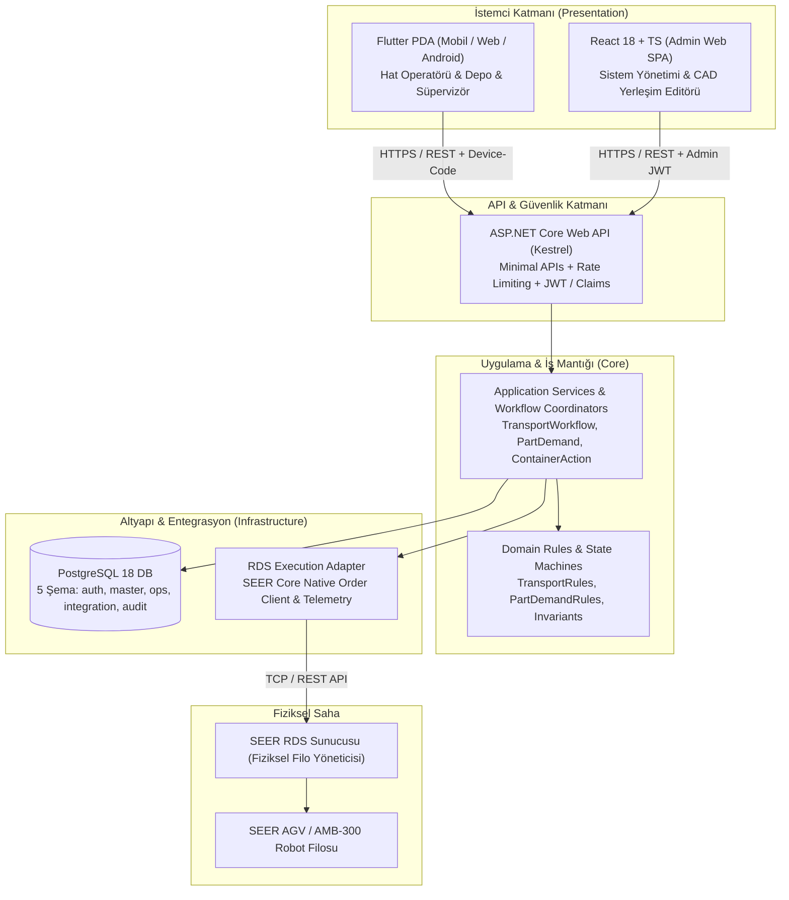
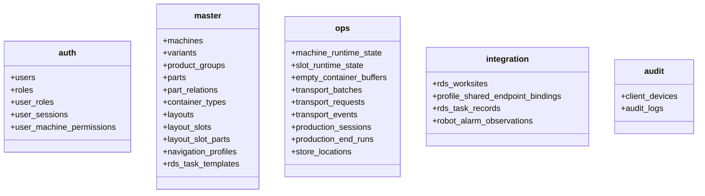
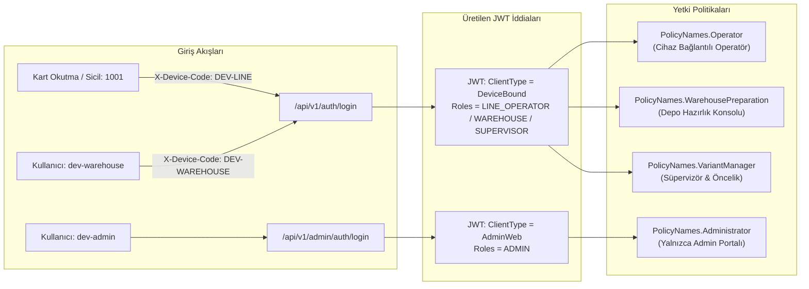

# TKG Otomotiv PDA & AGV Filo Yönetim Sistemi
## Kapsamlı Sistem Mimarisi, Kod Tabanı ve Teknik İnceleme Raporu

**Proje:** TKG Otomotiv — Pres ve Montaj Hatları Malzeme Çağrı, Kasa Takip, Depo Hazırlık ve Otonom Robot (AGV) Yönetim Sistemi  
**Doküman Sürümü:** 1.0.0 (Kapsamlı Teknik Rapor)  
**Tarih:** Ekim 2026  
**Hedef Kitle:** Baş Mimarlar, Kıdemli Yazılım Mühendisleri, IT/OT Entegrasyon Ekipleri, Proje Yöneticileri  

---

## 1. Yönetici Özeti ve Sistemin Amacı

TKG Otomotiv fabrikasında pres ve montaj hatlarında yürütülen malzeme besleme operasyonları; hat operatörleri, yarı mamul/mamul depoları ve fabrika içi otonom mobil robotlar (SEER AGV / AMB-300 filosu) arasında gerçek zamanlı ve hatasız bir koordinasyon gerektirir.

**TKG PDA Sistemi**, malzeme lojistiğini dijitalleştirerek şu temel hedefleri gerçekleştirir:
1. **Sıfır Hat Duruşu:** Malzeme tükendiğinde veya mamul kasası dolduğunda operatörün tek dokunuşla depo ve robot çağrısı başlatabilmesi.
2. **Yalın Operatör Deneyimi (UX):** Operatörün karmaşık robot haritaları, koordinatlar veya istasyon ID'leri ile ilgilenmeden; yalnızca `Makine -> Parça -> İşlem (Kasa Doldu / Boş Kasa Getir)` hiyerarşisiyle çalışması. Fiziksel slot, robot görevi ve depo rotalamasının arka planda deterministik kurallarla çözülmesi.
3. **Depo Koordinasyonu (Warehouse Readiness):** İçi dolu malzeme taşıma (`BRING_FULL`) taleplerinde robotun hemen hatta gitmesi yerine, depoda malzemenin hazırlandığı teyit edilene kadar robotun bekletilmesi; böylece sahada robotların boş yere beklemesinin veya hatalı malzeme tesliminin önlenmesi.
4. **Katı Donanım Güvenliği ve Mimari Sınırlar:** İstemcilerin (PDA / Admin) asla doğrudan SEER RDS robot yönetim sunucusuna bağlanamaması; tüm durum değişikliklerinin veritabanı işlemleri, denetim günlüğü (audit) ve idempotency kilitlerinden geçmesi.

---

## 2. Genel Mimari Yapı ve Veri Akışı

Sistem katmanlı (Clean Architecture / N-Tier) bir mimari üzerine kuruludur. Bağımlılık yönü her zaman dış katmanlardan iç katmanlara (Domain) doğrudur.



### Katmanlar Arası Temel Kurallar
* **İstemciler $\rightarrow$ API:** İstemciler (PDA ve Admin Web) yalnızca ASP.NET Core API uç noktalarını çağırabilir. RDS sunucusuna asla doğrudan bağlantı kurulamaz.
* **API $\rightarrow$ Application / Domain:** API denetleyicileri iş mantığı işletmez. Görev durumu, rezervasyon ve rotalama kuralları `TkgPda.Domain` ve `TkgPda.Application` katmanında yürütülür.
* **Application $\rightarrow$ PostgreSQL:** PostgreSQL operasyonel durumun, müşteri ana verilerinin ve denetim loglarının tek doğruluk kaynağıdır (Single Source of Truth).
* **Application $\rightarrow$ RDS Adaptörü:** Donanım mutasyonları (görev fırlatma, iptal, robot duraklatma) yalnızca fiziksel erişim izni verildiğinde ve RDS Dispatch açık olduğunda tetiklenir.

---

## 3. Alan Katmanı (`TkgPda.Domain`)

Alan katmanı, hiçbir dış kütüphaneye veya veritabanına bağımlı olmayan saf C# nesnelerinden oluşur.

### 3.1. Durum Makineleri ve Değişmezler (Invariants)

1. **Doluluk Durumları (`OccupancyState`):**
   * `VACANT`: Konumda hiçbir kasa yok.
   * `OCCUPIED`: Konumda fiziksel bir kasa mevcut.
   * `UNKNOWN`: Konum durumu henüz tespit edilemedi veya sensörsüz.
   * *(Kritik Kural: `RESERVED` bir doluluk durumu değildir. Rezervasyonlar `ops.transport_requests` tablosundaki aktif görev kayıtlarıdır).*

2. **Yük Durumları (`LoadState`):**
   * `EMPTY`: Kasa boş.
   * `FULL`: Kasa parçayla dolu.
   * `UNKNOWN`: Kasanın yük durumu belirsiz.

3. **Taşıma Operasyonları (`TransportTaskType`):**
   * `BRING_EMPTY`: Pres hattına boş kasa getirme. Tamamlandığında hedef slotu `OCCUPIED` + `EMPTY` yapar.
   * `BRING_FULL`: Depodan hatta parça dolu kasa teslimatı. Tamamlandığında hedef slotu `OCCUPIED` + `FULL` yapar. Depo hazırlık onayı (`WAITING_WAREHOUSE` $\rightarrow$ `READY`) olmadan AGV'ye sevk edilmez.
   * `REMOVE_FULL`: Dolu mamul kasasını hattan alıp mamul ambarına taşıma. Tamamlandığında kaynak slotu `VACANT` yapar.
   * `REMOVE_EMPTY`: Hattan boşalan kasayı toplama (yalnızca dahili temizlik/üretim sonu akışında). Operatör tarafından doğrudan seçilemez.

4. **Görev Yaşam Döngüsü (`TransportRequestStatus`):**
   ```text
   CREATED -> VALIDATING -> QUEUED -> SENT_TO_RDS -> RUNNING -> COMPLETED
                                  \            \         \
                                   +------------+---------+--> CANCELLED / FAILED
   ```

5. **Depo Hazırlık Durumu (`TransportReadinessState`):**
   * `NOT_REQUIRED`: `BRING_EMPTY` ve `REMOVE_FULL` gibi depo hazırlığı gerektirmeyen operasyonlar.
   * `WAITING_WAREHOUSE`: `BRING_FULL` oluşturulduğunda depodaki hazırlığı bekleyen başlangıç durumu.
   * `READY`: Depo operatörünün malzemeyi hazırlayıp sisteme bildirdiği durum.

### 3.2. Müşteri Hiyerarşisi Modeli
Müşteri verisinin hiyerarşisi kesin olarak şöyledir:
$$\text{Makine (Machine)} \longrightarrow \text{Varyant (Variant)} \longrightarrow \text{Ürün Grubu (Product Group)} \longrightarrow \text{Parça (Part / Alternative Part)}$$
* Bir **Ürün Grubu**, kesinlikle bir Varyant değildir; bir varyantın altında üretilen mamul grubudur.
* Bir makinede aynı anda **yalnızca tek bir varyant** aktif olabilir.

---

## 4. Uygulama Katmanı (`TkgPda.Application`)

Uygulama katmanı, iş kurallarını orkestre eden servisleri, erişim politikalarını ve RDS koordinatörünü barındırır.

### 4.1. Temel Servisler ve Görevleri

| Servis Adı | Bulunduğu Dosya | İşlev / Sorumluluk |
| :--- | :--- | :--- |
| [`PartDemandService`](file:///c:/Users/fatih.cetintas/Desktop/TKG_PDA/src/TkgPda.Application/PartDemand.cs) | `PartDemand.cs` | Hat operatörünün alt parça taleplerini (`BRING_FULL`) tekil veya toplu (`batch`) olarak doğrular ve oluşturur. |
| [`ContainerActionService`](file:///c:/Users/fatih.cetintas/Desktop/TKG_PDA/src/TkgPda.Application/ContainerActions.cs) | `ContainerActions.cs` | Kasa Doldu (`REMOVE_FULL`) ve Boş Kasa İste (`BRING_EMPTY`) butonlarının konum durumuna göre tetiklenmesini yönetir. |
| [`TransportWorkflowService`](file:///c:/Users/fatih.cetintas/Desktop/TKG_PDA/src/TkgPda.Application/TransportWorkflowService.cs) | `TransportWorkflowService.cs` | Taleplerin iptal edilmesi, yeniden başlatılması (`redo`) ve durum geçişlerinin yönetimini sağlar. |
| [`WarehousePreparationService`](file:///c:/Users/fatih.cetintas/Desktop/TKG_PDA/src/TkgPda.Application/WarehousePreparation.cs) | `WarehousePreparation.cs` | Depodaki hazırlık taleplerinin listelenmesi, palet tahsisi ve `MarkReady` onayı verilmesini yönetir. |
| [`ProductionSessionService`](file:///c:/Users/fatih.cetintas/Desktop/TKG_PDA/src/TkgPda.Application/ProductionSessions.cs) | `ProductionSessions.cs` | Hatta "Üretime Başla" ve "Üretimi Bitir" oturumlarının yaşam döngüsünü ve kilitlerini kontrol eder. |
| [`RdsExecutionCoordinator`](file:///c:/Users/fatih.cetintas/Desktop/TKG_PDA/src/TkgPda.Application/RdsExecution.cs) | `RdsExecution.cs` | Veritabanındaki hazır talepleri SEER RDS formatına dönüştürerek AGV'ye dispatch eder veya geri çeker. |
| [`RdsPhysicalAvailabilityPolicy`](file:///c:/Users/fatih.cetintas/Desktop/TKG_PDA/src/TkgPda.Application/RdsPhysicalAvailabilityPolicy.cs) | `RdsPhysicalAvailabilityPolicy.cs` | Hedef WorkSite'ın fiziksel doluluğunu ve robot rotasını denetleyerek çakışmaları engeller. |
| [`AdminConfigurationService`](file:///c:/Users/fatih.cetintas/Desktop/TKG_PDA/src/TkgPda.Application/AdminConfigurationService.cs) | `AdminConfigurationService.cs` | Hatlar, yerleşim slotları, kullanıcılar, roller ve cihaz izinlerinin CRUD yönetimini sağlar. |

---

## 5. Veritabanı ve Kalıcılık Katmanı (`TkgPda.Infrastructure.Postgres`)

Projede ORM / Entity Framework migration'ları **kesinlikle yasaktır**. Tüm veritabanı şeması **26 adet sıralı ham SQL migration** dosyası ile yönetilir.

```text
db/migrations/
├── 001_initial_schema.sql                  -> 5 ana şema ve temel tablolar
├── 002_operator_employee_identity.sql      -> Şifresiz sicil no kimlik desteği
├── 003_transport_batch.sql                 -> Çoklu talep gruplama (batch)
├── 004_transport_request_readiness.sql     -> Depo hazırlık durumu (readiness_state)
├── 005_layout_slot_part_mapping.sql        -> master.layout_slot_parts eşleşmesi
├── 006_production_sessions.sql             -> Üretim oturumları ve hat kilitleri
├── 007_bring_full_task_type.sql            -> BRING_FULL görev tipi desteği
├── 008_warehouse_preparation_areas.sql     -> Depo hazırlık bölgeleri
├── 009_preparation_placement_key.sql       -> Palet yerleşim anahtarları
├── 010_finished_goods_store.sql            -> Mamul ambarı lokasyonları (FG-01..19)
├── 011_warehouse_operator_roles.sql        -> Yarı mamul ve mamul depo rol ayrımı
├── 012_client_device_machine_binding.sql   -> Tablet cihaz - makine eşleşmesi
├── 013_user_sessions.sql                   -> Tekil aktif oturum kontrolü
├── 014_transport_event_context.sql         -> Denetim günlüğü olay bağlamı
├── 015_part_demand_dependencies.sql        -> Öncül görev bağımlılıkları
├── 016_finished_goods_areas.sql            -> Mamul ambarı mantıksal alanları
├── 017_internal_device_notifications.sql   -> Dahili cihaz bildirim havuzu
├── 018_production_end_priorities.sql       -> Üretim sonu tahliye öncelikleri
├── 019_robot_alarm_observations.sql        -> RDS alarm gözlem tablosu
├── 020_robot_alarm_observation_state.sql   -> Alarm durum geçmişi
├── 021_production_end_cleanup.sql          -> Üretim sonu temizlik optimizasyonu
├── 022_variant_scoped_rds_worksite_commissioning.sql -> Varyant bazlı WorkSite eşleşmesi
├── 023_rds_variant_commissioning_hardening.sql       -> Devreye alma kural sıkılaştırması
├── 024_operational_reporting.sql           -> Vardiya ve operasyonel raporlar
├── 025_profile_scoped_shared_endpoints.sql -> Ortak bitiş noktası bağlamı
└── 026_canonical_shared_endpoint_identities.sql     -> Standart paylaşımlı nokta ID'leri
```

### 5.1. Şema Yapısı ve İzolasyon



### 5.2. Eşzamanlılık Kilitleri ve Deadlock Koruması
* **Makine Seviyesi Kilitlenme (A02 Düzeltmesi):** Malzeme talebi (`CreatePartDemand`) ve Üretim Sonu (`ProductionEnd`) işlemlerinde oturum ve makine kilitleri arasındaki ters sıra giderilmiştir. Her iki akış da önce `master.machines` veya `ops.machine_runtime_state` kaydını `SELECT ... FOR UPDATE` ile kilitler; ardından oturum ve talep kayıtlarını kilitler. Bu sayede eşzamanlı tıklamalarda PostgreSQL `deadlock_detected` (55P03) hatası tamamen engellenmiştir.
* **Idempotency Güvencesi:** Her kritik istek HTTP başlığında `Idempotency-Key` taşır. Mükerrer gelen istekler tekrar görev oluşturmaz; önceden oluşturulmuş görevin yanıtını döner (`WasIdempotentReplay = true`).

---

## 6. SEER RDS Donanım Entegrasyon Katmanı

Robot filo yönetimi, SEER RDS Core API standartlarına tam uyumlu olarak gerçekleştirilir.

### 6.1. Adaptör Mimarisi
* [`RdsCoreNativeOrderClient`](file:///c:/Users/fatih.cetintas/Desktop/TKG_PDA/src/TkgPda.Api/RdsCoreNativeOrderClient.cs): SEER RDS sunucusuna görev oluşturma (`createOrder`), görevi iptal etme (`cancelOrder`), robotları duraklatma/devam ettirme ve hata temizleme komutlarını ileten yerel istemcidir.
* [`RdsReadClient`](file:///c:/Users/fatih.cetintas/Desktop/TKG_PDA/src/TkgPda.Api/RdsReadClient.cs): RDS üzerinden robot telemetrisini (batarya, hız, çevrimiçi durumu, aktif alarmlar) okuyan salt-okunur (read-only) istemcidir.
* **Alarm İzolasyonu:** RDS alarmları yalnızca `GET /api/agv-report/core` üzerinden okunur. Bir alarmın okunması veya düşmesi, slot doluluk durumunu veya yük durumunu **asla değiştiremez**.

---

## 7. Web API ve Güvenlik Katmanı (`TkgPda.Api`)

Sunucu, .NET 10 üzerinde çalışan yüksek performanslı bir Kestrel Web API'sidir.

### 7.1. Kimlik Doğrulama ve Yetkilendirme Sınırları

Üç farklı kimlik doğrulama kanalı bulunur:
1. **Üretim Operatörü (Production Operator):** `employeeNumber` + `X-Device-Code` (Şifresiz Sicil Girişi). Saha tabletlerinde hızlı kart okutma için tasarlanmıştır.
2. **Eski/Klasik Operatör (Legacy Operator):** `username` + `password` + `X-Device-Code`.
3. **Sistem Yöneticisi (Admin):** `username` + `password` (PDA cihaz kodu zorunluluğu yoktur; `ClientType: AdminWeb` claim'i taşır).



### 7.2. Hata Yönetimi (`ApiProblem`)
API, RFC 7807 (Problem Details) standardına tam uyumludur. Hata durumlarında ham istisnalar veya stack trace'ler dışarı sızdırılmaz. PDA arayüzü, 51 adet kaynağa dayalı net operatör mesajı ile kullanıcıyı yönlendirir (Örn: `SLOT_STATE_MISMATCH`, `PREPARATION_PALLET_REQUIRED`, `FINISHED_GOODS_CAPACITY_UNAVAILABLE`).

---

## 8. Hat Operatörü PDA İstemcisi (`TkgPda.Pda` - Flutter)

Operatör paneli Flutter ile geliştirilmiş olup; Android tabletler, el terminalleri (Honeywell, Zebra) ve Web tarayıcılarında kusursuz çalışacak şekilde derlenmiştir.

### 8.1. Arayüz Bileşenleri ve Ekranlar
* [`LoginScreen`](file:///c:/Users/fatih.cetintas/Desktop/TKG_PDA/src/TkgPda.Pda/lib/features/login/login_screen.dart): Şifresiz Sicil No veya kullanıcı adı ile tek adımda oturum açma.
* [`MachineListScreen`](file:///c:/Users/fatih.cetintas/Desktop/TKG_PDA/src/TkgPda.Pda/lib/features/machines/machine_list_screen.dart): Fabrikadaki 9 makinenin anlık durumunu, aktif varyantını ve görev sayısını listeleyen seçim ekranı.
* [`OperationScreen`](file:///c:/Users/fatih.cetintas/Desktop/TKG_PDA/src/TkgPda.Pda/lib/features/operation/operation_screen.dart): Pres hattı çalışma alanı.
  * **Mamul Kasa Bölümü ([`ContainerPositionPanel`](file:///c:/Users/fatih.cetintas/Desktop/TKG_PDA/src/TkgPda.Pda/lib/features/operation/container_position_panel.dart)):** Fiziksel slotların CAD düzeninde yerleşimi, kasa dolulukları ve "Kasa Doldu" / "Boş Kasa Getir" butonları.
  * **Parça Talep Bölümü ([`PartFirstScreen`](file:///c:/Users/fatih.cetintas/Desktop/TKG_PDA/src/TkgPda.Pda/lib/features/operation/part_first_screen.dart)):** Malzeme seçimi ve tekil/toplu `BRING_FULL` çağrıları.
* [`WarehousePreparationScreen`](file:///c:/Users/fatih.cetintas/Desktop/TKG_PDA/src/TkgPda.Pda/lib/features/warehouse/warehouse_preparation_screen.dart): Depo görevlisinin bekleyen parça siparişlerini onayladığı konsol.
* [`OperatorQueueScreen`](file:///c:/Users/fatih.cetintas/Desktop/TKG_PDA/src/TkgPda.Pda/lib/features/tasks/operator_queue_screen.dart): Hatta doğru gelen veya depoda bekleyen tüm AGV görevlerinin canlı takip listesi.

---

## 9. Yönetim Paneli (`TkgPda.AdminWeb` - React / TypeScript)

Yönetim paneli; Vite, React 18 ve TypeScript ile geliştirilmiş modern bir tek sayfa uygulamasıdır (SPA).

### 9.1. Temel Sayfalar ve Yetenekler
* **Dashboard ([`DashboardPage.tsx`](file:///c:/Users/fatih.cetintas/Desktop/TKG_PDA/src/TkgPda.AdminWeb/src/pages/DashboardPage.tsx)):** Canlı sistem sağlığı, aktif görev sayıları ve sistem uyarıları.
* **CAD Yerleşim Editörü ([`LayoutEditorPage.tsx`](file:///c:/Users/fatih.cetintas/Desktop/TKG_PDA/src/TkgPda.AdminWeb/src/pages/LayoutEditorPage.tsx)):** Pres hattı slotlarının (Pick, Drop, Storage) koordinatlarını, genişlik/yüksekliklerini interaktif olarak düzenleme ve yayınlama (`Publish`).
* **RDS & Robot Yönetimi ([`RdsIntegrationPage.tsx`](file:///c:/Users/fatih.cetintas/Desktop/TKG_PDA/src/TkgPda.AdminWeb/src/pages/RdsIntegrationPage.tsx)):** Robotların canlı telemetrisi, acil duraklatma (`Pause`), hata temizleme ve WorkSite eşitleme.
* **Kullanıcı ve Cihaz Yönetimi ([`UsersPage.tsx`](file:///c:/Users/fatih.cetintas/Desktop/TKG_PDA/src/TkgPda.AdminWeb/src/pages/UsersPage.tsx), [`DevicesPage.tsx`](file:///c:/Users/fatih.cetintas/Desktop/TKG_PDA/src/TkgPda.AdminWeb/src/pages/DevicesPage.tsx)):** Personel rolleri, cihaz-makine yetkilendirmeleri.
* **Denetim Günlüğü ([`AuditPage.tsx`](file:///c:/Users/fatih.cetintas/Desktop/TKG_PDA/src/TkgPda.AdminWeb/src/pages/AuditPage.tsx)):** Kimin, hangi terminalden, saat kaçta hangi butona bastığının değişmez denetim kaydı.

---

## 10. Çevrimdışı Demo ve Simülasyon Alt Sistemi

Projenin en yeni bileşeni olan Çevrimdışı Demo Modu, canlı robot olmaksızın sunum yapılabilmesini sağlar.

### 10.1. Demo Bileşenleri
* [`DemoModeOptions`](file:///c:/Users/fatih.cetintas/Desktop/TKG_PDA/src/TkgPda.Api/DemoModeOptions.cs): `appsettings.json` içerisindeki `"DemoMode:Enabled": true` anahtarıyla aktifleşir.
* [`DemoSimulationWorker`](file:///c:/Users/fatih.cetintas/Desktop/TKG_PDA/src/TkgPda.Api/DemoSimulationWorker.cs): Arka planda (`IHostedService`) çalışan bir durum makinesi yürütücüsüdür.
  * Oluşturulan her görevi yakalar.
  * `QUEUED` durumundaki görevi 2 saniye sonra `SENT_TO_RDS` ve `RUNNING` yapar.
  * 3 saniye sonra `COMPLETED` yaparak pres hattındaki slotun doluluk durumunu günceller.
  * İptal, öncelik değiştirme, manuel tamamlama ve yeniden başlatma butonlarının tamamını hatasız işletir.
* **Karşılama Sayfası ([`TkgStaticWebHosting.cs`](file:///c:/Users/fatih.cetintas/Desktop/TKG_PDA/src/TkgPda.Api/TkgStaticWebHosting.cs)):** `http://localhost:5000/` adresinde açılan, hem PDA'ya hem Admin'e yönlendiren ve üzerinde hazır kullanıcı hesaplarını gösteren interaktif portal.

---

## 11. Dağıtım, Windows Servisi ve Paketleme

Sistem, endüstriyel Windows ortamlarına tamamen bağımsız olarak kurulabilecek şekilde tasarlanmıştır.

```text
tools/deployment/
├── build-production-release.ps1 -> Canlı üretim kurulum paketi derleyici
├── build-demo-release.ps1       -> Demo simülasyon kurulum paketi derleyici
├── demo_installer.iss           -> Inno Setup 6 kurulum derleme betiği
├── Install-TkgServer.ps1        -> Otomatik servis ve DB kurucu
└── manifest.json                -> Dosya SHA-256 bütünlük kontrol tablosu
```

### 11.1. Üretilen Çıktı Paketleri
1. **Demo Kurulum Paketi:** `artifacts/release/1.0.0/TKG_PDA_Demo_Setup_1.0.0.exe` (71.08 MB)
   * İçinde gömülü PostgreSQL 18 motoru bulunur.
   * Self-contained (Framework gerektirmeyen) win-x64 .NET 10 API servisi barındırır.
   * Derlenmiş Flutter Web ve React Admin SPA dosyalarını içerir.
   * Kurulum tamamlandığında Windows Servisi (`TkgPdaService`) olarak başlar ve port 5000 üzerinden yayına geçer.
2. **Kılavuz Dokümanı:** [TKG_PDA_Demo_Surumu_Kullanim_Kilavuzu.docx](file:///C:/Users/fatih.cetintas/Desktop/TKG_PDA_Demo_Surumu_Kullanim_Kilavuzu.docx) (Masaüstünde kullanıma hazır).

---

## 12. Kalite Güvencesi ve Test Mimarisi

Sistem, 1.490'ın üzerinde otomatik test ile endüstriyel güvenilirlik standartlarını karşılar:

| Test Projesi / Paketi | Test Sayısı | Kapsam | Durum |
| :--- | :---: | :--- | :---: |
| **`TkgPda.Domain.Tests`** | 146 | İş kuralları, durum makineleri, değişmezler | **%100 PASS** |
| **`TkgPda.Application.Tests`** | 327 | Koordinatörler, politikalar, servisler | **%100 PASS** |
| **`TkgPda.Auth.Tests`** | 15 | PBKDF2 hash, JWT token üretimi, kimlik doğrulama | **%100 PASS** |
| **`TkgPda.Infrastructure.Postgres.Tests`** | 83 | 26 SQL migration, şema bütünlüğü, transaction kilitleri | **%100 PASS** |
| **`TkgPda.Api.Tests`** | 549 | Tüm HTTP rotaları, yetki sınırları, simülasyon modu | **%100 PASS** |
| **Flutter Widget / Unit Tests** | 296 | Mobil ekranlar, buton tıklamaları, reaktif state | **%100 PASS** |
| **React Admin Unit / UI Tests** | 66 | Yönetim paneli rotaları, CAD editörü, filo bileşenleri | **%100 PASS** |
| **Browser E2E / Assertion Tests** | 8 | Tarayıcı uçtan uca senaryoları | **%100 PASS** |
| **TOPLAM OTOMATİK TEST** | **1.490** | **Tüm Katmanlar** | **%100 YEŞİL** |

---

## 13. Müşteri Verisi ve Fabrika Hatları Durumu

Sistemde müşterinin resmi dokümanlarına dayalı 9 ana hat tanımlıdır:

| Makine Kodu | Hat Tipi | Tanımlı Varyantlar | Fiziksel Slot Sayısı | Durum |
| :--- | :--- | :--- | :---: | :--- |
| **SH-01-A** | Pres Hattı | V1, V2, V3, V4, V5 | 12 Slot | Simülasyona Tam Hazır |
| **SH-01-B** | Pres Hattı | V1, V2, V3 | 9 Slot | Simülasyona Tam Hazır |
| **SH-01-P1--SH-01-P2** | Çiftli Pres | V1, V2 | 15 Slot | Simülasyona Tam Hazır |
| **SH-02-P1 -SH-02-P2** | Çiftli Pres | V1, V2 | 9 Slot | Simülasyona Tam Hazır |
| **SEALER** | Mastik / Yapıştırma | V1, V2 (V3 beklemede) | 15 Slot | V1-V2 Hazır (V3 Yerleşim Bekleniyor) |
| **PAH-01-A** | Pah Kırma | V1, V2 | 7 Slot | Simülasyona Tam Hazır |
| **412B** | Montaj Hattı | V1, V2, V3 | 8 Slot | Simülasyona Tam Hazır |
| **PAH-02-A** | Pah Kırma | V1, V2 | 6 Slot | Simülasyona Tam Hazır |
| **GAR** | Kaynak Hattı | V1, V2, V3 | 9 Slot | Simülasyona Tam Hazır |

---

## 14. Mevcut Durum, Açık İşler ve Yol Haritası

Müşteri Kabul Denetimi ([`TKG_POST_ACCEPTANCE_AUDIT.md`](file:///c:/Users/fatih.cetintas/Desktop/TKG_PDA/docs/customer/TKG_POST_ACCEPTANCE_AUDIT.md)) doğrultusunda sistemin önündeki kalan konular şunlardır:

### 14.1. Müşteriden Beklenen Veri Eksikleri (Dış Blokeler)
* **25 Adet ALT Parça Kasa/Lot Bilgisinin Boş Olması:** `master.parts` ve `master.part_relations` tablolarında müşteri Excel kaynağında kasa tipi girilmemiş 25 alt parça bulunmaktadır. Sistem, kasa tipi (KLT, Sandık, Palet) tanımlı olmayan parçalar için iş kuralı gereği malzeme çağrısına izin vermez. Bu parçalar PDA'da `Talep Edilemez` olarak görünür.
* **SEALER V3 Hattı CAD/Fiziksel Yerleşimi:** SEALER presinin V1 ve V2 varyantları hazırdır; ancak V3 varyantı için resmi CAD/slot çizimi müşteriden beklenmektedir.
* **19 Adet Mamul (FG) Alanının İsimlendirmesi:** `ops.store_locations` tablosundaki `FG-01` .. `FG-19` arası lokasyonların sahadaki tabela / hol isimleri müşteriden beklenmektedir.
* **Üretim Sonu Öncelik Tablosu Onayı:** Hattan kasa tahliyesinde kullanılan öncelikler (`REMOVE_FULL=40`, `REMOVE_EMPTY=70`) geliştirici varsayılanıdır; fabrika tarafından resmileştirilmelidir.
* **Barkod Eşleştirme Sözleşmesi:** Toplantı notlarında geçen barkod okutma fonksiyonu için veri formatı ve doğrulama sözleşmesi müşteriden beklenmektedir.

### 14.2. Yazılım ve Fonksiyonel Backlog Eksikleri
* **A20 — M4 Robot Aktif Görev & Park/Şarj Yönetimi:** Robot yönetim ekranında AGV'leri doğrudan "Şarja Git" veya "Park / Bekleme Noktasına Git" komutuyla yönlendirme iş akışı Domain ve API seviyesinde henüz modellenmemiştir.
* **A09 — Yönetim Paneli Hazırlık / Teşhis Ekranı (Readiness Diagnostics):** Eksik müşteri verilerini, tamamlanmamış yerleşimleri ve harita eşleşmelerini Admin panelinde tek bakışta gösteren görsel tanı panosu.
* **Dinamik Varış Süresi (ETA) Telemetrisi:** RDS'ten canlı süre gelmediğinde sabit sayı uydurmak yerine dürüstçe `UNAVAILABLE` dönülmektedir; canlı telemetriye dayalı dinamik süre algoritması geliştirilmelidir.

### 14.3. Saha ve Donanım Devreye Alma Eksikleri
* **Navigasyon Profillerinin `DRAFT` Durumunda Olması:** Veritabanındaki tüm harita profilleri (`TKG_SH01A_V01_NAV`, vb.) taslaktır. Sahada SEER üzerinde kalibrasyon yapılmadan `PUBLISHED` durumuna alınamaz.
* **Fiziksel İstasyon Eşleşmeleri (0 / 0 / 0):** `FG`, `RETURN` ve `EMPTY` istasyonlarının canlı RDS üzerindeki fiziksel koordinatları, çatal yükseklikleri ve reflektör tanımları sahada onaylanmalıdır.
* **Fiziksel Saha Güvenlik Testleri:** Canlı robot önüne engel/insan çıkması durumunda tablet ve sistem tepkilerinin saha ortamında doğrulanması.

### 14.4. Mimari ve Teknik Borç İyileştirme Alanları
* **Tablet Arka Plan Bildirimleri (Native Push):** Tablet ekranı kapandığında işletim sistemi seviyesinde yerel Android/Windows push bildirim entegrasyonu.
* **Depo - Operatör İki Yönlü Mesajlaşma:** `BRING_FULL` bekleme durumunda deponun hatta açıklama gönderebilmesi.
* **Mevcut Çalışma Dalı Temizliği (`agent/tkg-production-installer`):** Demo modu değişikliklerinin commit'lenip PR aşamasına getirilmesi.

---

### Sonuç ve Değerlendirme

TKG PDA sistemi; katı mimari kuralları, SQL tabanlı deterministik şeması, PostgreSQL eşzamanlılık kilitleri, 1.490 adet otomatik testi, bağımsız kurulum paketi ve canlı simülasyon modu ile **üretim kalitesinde (production-grade) eksiksiz bir endüstriyel yazılım altyapısına** sahiptir.

